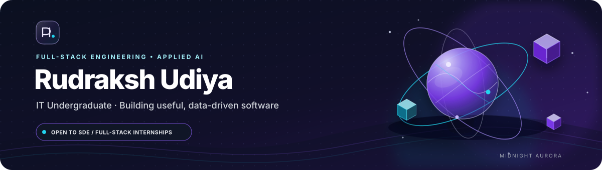

<!--
Profile README: @rudraksha127
Design system: Midnight Aurora — midnight navy, violet, electric cyan, and restrained neutrals.
Keep project status and credentials accurate; replace outdated evidence before job applications.
-->

  <a href="#profile-at-a-glance">Profile</a> ·
  <a href="#selected-work">Selected Work</a> ·
  <a href="#technical-toolkit">Toolkit</a> ·
  <a href="#credentials--coding-profiles">Credentials</a> ·
  <a href="#github-activity">Activity</a>

## Profile at a glance

I'm an **Information Technology undergraduate at Acropolis Institute of Technology & Research, Indore (2024–2028)**, focused on **full-stack software engineering and applied AI**.

I like building practical systems end to end: designing clear user workflows, implementing APIs and data pipelines, testing edge cases, and documenting how a project runs.

- **Target roles:** SDE / Full-Stack Engineering internships
- **Engineering interests:** Reliable backend services, data-intensive applications, developer tools, and AI-enabled workflows
- **Current learning:** DSA, system design, application security, and dependable AI integration

## Selected work

### [01 · AI MANTHAN 2.0 — Event PWA](https://github.com/rudraksha127/AI-MANTHAN-2K26) · [Live site](https://www.nex-ai.in)

A mobile-first event platform with installable PWA support, service-worker caching, offline fallback, and a queued support workflow.

**Stack:** Next.js · React · Tailwind CSS · Progressive Web App

**Why it matters:** Demonstrates a deployed web experience alongside offline-aware frontend behavior. The live site was accessible during this review.

### [02 · Finance AI — Time-Series Research Pipeline](https://github.com/rudraksha127/Finance-Ai) · [Integration & QA report](https://github.com/rudraksha127/Finance-Ai/blob/main/docs/MVP_INTEGRATION_QA_REPORT.md)

A reproducible financial-data research workflow spanning ingestion, data quality, feature/label generation, dataset versioning, model experiments, backtesting, an inference API, and a dashboard.

**Stack:** Python · Time-series ML · API · TypeScript dashboard

**Scope note:** This is a research-only system. The repository explicitly states that it does not execute live trades or broker orders.

### [03 · Abhedya-Drishti / FraudLens AI — Cyber-Forensics Prototype](https://github.com/rudraksha127/Abhedya-Drishti)

A financial transaction analysis prototype built around structured ingestion, vectorized data processing, transaction-graph exploration, and investigation-triage outputs.

**Stack:** Next.js · FastAPI · Polars · DuckDB · NumPy

**Scope note:** Algorithmic outputs are investigative leads for human review—not a determination of guilt or a claim of legal admissibility.

### [04 · Portfolio — Interactive Developer Website](https://github.com/rudraksha127/Portfolio)

A space-inspired portfolio interface with modular sections for projects, skills, education, experience, certifications, and contact.

**Stack:** Next.js 16 · React 19 · TypeScript · Tailwind CSS · Three.js · Framer Motion

**Explore:** Source code and implementation details are available in the repository.

## Technical toolkit

  

| Area | Selected skills |
|---|---|
| **Languages** | C++, Java, Python, JavaScript, TypeScript |
| **Frontend** | React, Next.js, HTML, CSS, Tailwind CSS |
| **Backend & data** | Node.js, Express, Flask, MongoDB, PostgreSQL |
| **Cloud & delivery** | AWS, Docker, Git, GitHub Actions, CI/CD fundamentals |
| **Applied AI** | LLM integration, RAG patterns, agent workflows, multimodal applications |

*This is a working toolkit, not a claim of equal proficiency in every technology. Project repositories provide the implementation context.*

## Credentials & coding profiles

The existing profile lists AWS certifications across Cloud, AI, Architecture, Development, Data Engineering, Machine Learning, and Cloud Operations, plus other technical credentials. Use the resume link above for the current credential list; make sure the PDF is up to date before applying.

**Coding profiles:** [GeeksforGeeks](https://www.geeksforgeeks.org/user/rudraksha127) · [LeetCode](https://leetcode.com/rudraksha127) · [HackerRank](https://www.hackerrank.com/rudraksha127) · [CodeChef](https://www.codechef.com/users/rudraksha127)

## GitHub activity

  
<strong>Contribution snake</strong>

   
  

    
  

---

  Build with curiosity. Engineer with care. Keep shipping.

